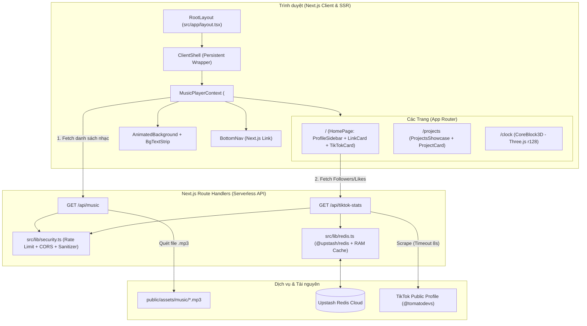

# 🏗️ Kiến trúc Hệ thống & Luồng Hoạt Động (`ARCHITECTURE.md`)

Tài liệu này giải thích chi tiết cấu trúc bên trong của dự án và cách các thành phần giao tiếp với nhau.

---

## 1. Sơ đồ kiến trúc tổng thể

---

## 2. Giải thích các phân hệ cốt lõi

### 2.1. Hệ thống Phát Nhạc Xuyên Trang (`src/components/player/`)

Trong ứng dụng web thông thường, khi chuyển từ `/` sang `/projects`, trang web sẽ tải lại và làm nhạc bị ngắt. Dự án này giải quyết triệt để vấn đề đó như sau:

1. **`MusicPlayerContext.tsx`**:
   - Được đặt trong `ClientShell.tsx` thuộc `RootLayout` (`src/app/layout.tsx`). Trong Next.js App Router, `RootLayout` **không bao giờ bị unmount** khi người dùng chuyển giữa các route con (`/`, `/projects`, `/clock`).
   - Giữ một thẻ `<audio id="bg-music">` duy nhất.
   - Tự động lưu và khôi phục trạng thái vào `localStorage`:
     - `music_track_file` & `music_track_index`: Bài hát đang phát dở.
     - `music_current_time`: Giây đang phát hiện tại.
     - `music_volume`: Mức âm lượng.
     - `music_paused`: Trạng thái người dùng chủ động tạm dừng hay đang phát.
2. **Hai chế độ hiển thị đồng bộ (`PlayerPanel.tsx` & `FloatingPlayer.tsx`)**:
   - **Trên trang chủ `/` (Desktop `>= 1025px`)**: Hiển thị bảng điều khiển nhạc đầy đủ (`PlayerPanel`) nằm ngay bên dưới cột Hồ sơ bên trái (`ProfileSidebar`). Khi mở danh sách phát (`isPlaylistExpanded = true`), class `playlist-is-expanded` được gắn vào `document.body` giúp phóng to ảnh bìa (`.cover-img`) cực kỳ mượt mà.
   - **Trên trang `/projects` và `/clock` (Desktop `>= 1025px`)**: Vì không có cột Sidebar bên trái, `FloatingPlayer` tự động kích hoạt class `mini-player-mode` ở góc dưới bên phải. Khi bấm vào nút nhạc tròn, nó bung rộng thành bảng điều khiển `340px` và tự động thu gọn sau `2.5 giây` khi chuột rời đi.
   - **Trên thiết bị di động (`<= 1024px`)**: Nút nhạc góc dưới bên phải khi bấm vào sẽ xòe ra 4 nút điều khiển hình cánh quạt (`Playlist`, `Prev`, `Play/Pause`, `Next`) và mở popup `MobilePlaylistModal` khi chọn xem danh sách bài hát.

---

### 2.2. Kết nối Upstash Redis & Thống kê TikTok (`src/lib/redis.ts` & `/api/tiktok-stats`)

Luồng lấy số lượng **Followers** và **Likes** của TikTok được thiết kế 4 tầng dự phòng (4-Layer Resilience) để đảm bảo giao diện luôn hiển thị số liệu nhanh và không bao giờ bị lỗi:

1. **Tầng 1 — Bộ đệm trình duyệt (`TikTokCard.tsx`)**:
   - Lưu kết quả vào `localStorage` (`tt_stats_cache`) trong vòng **30 phút**. Nếu người dùng tải lại trang trong 30 phút, dữ liệu hiển thị tức thì mà không cần gọi lại server.
2. **Tầng 2 — Scrape trực tiếp từ TikTok (`/api/tiktok-stats/route.ts`)**:
   - Server gửi request giả lập trình duyệt đến `https://www.tiktok.com/@tomatodevs` với `AbortSignal.timeout(8000)` (tối đa 8 giây).
   - Bóc tách dữ liệu qua 3 phương pháp tuần tự: thẻ JSON `__UNIVERSAL_DATA_FOR_REHYDRATION__` $\rightarrow$ biểu thức chính quy (Regex `followerCount`/`heartCount`) $\rightarrow$ `SIGI_STATE`.
3. **Tầng 3 — Bộ đệm `@upstash/redis` & RAM (`src/lib/redis.ts`)**:
   - Nếu lấy được số liệu mới từ TikTok, server lưu vào Upstash Redis với khóa `latest_follower` (TTL 24 giờ).
   - **Chống tràn Quota (Write Throttling)**: Nếu dữ liệu vừa được ghi trong vòng 10 phút gần nhất, hệ thống bỏ qua lệnh `redis.set` dư thừa để tiết kiệm request lên Upstash.
   - Nếu TikTok chặn IP server hoặc mạng chậm, server lấy ngay dữ liệu từ Upstash Redis (hoặc bộ đệm RAM nếu chạy local không cấu hình Redis).
4. **Tầng 4 — Số liệu tĩnh dự phòng (`profile.config.ts`)**:
   - Trong trường hợp cả TikTok lẫn Redis đều không khả dụng, API trả về giá trị `fallbackFollowers` và `fallbackLikes` từ file cấu hình.

---

### 2.3. Động cơ 3D Armillary Sphere (`src/components/clock/CoreBlock3D.tsx`)

Trang `/clock` tái hiện khối cầu năng lượng 3D sử dụng thư viện **`three` (phiên bản `0.128.0`)**:
- **CoreMesh**: Khối đa diện `IcosahedronGeometry` biến hình liên tục giữa 3 trạng thái địa chất (Tectonic, Wave, Ripple) kết hợp Custom Vertex/Fragment Shader tạo hiệu ứng lấp lánh theo độ sâu (`depthFade`).
- **FilamentSystem**: 20 sợi tia năng lượng (`THREE.Line`) uốn lượn quanh tâm.
- **AuraSystem**: Hố đen trung tâm (`blackHole`) bao quanh bởi 2 lớp cầu phát sáng Fresnel (`ShaderMaterial` với `AdditiveBlending`).
- **RingSystem & DebrisSystem**: Các vòng đá cổ đại cắt vát (`ExtrudeGeometry`) quay lệch trục cùng 30 mảnh thiên thạch đa diện bay xung quanh.
- **ParticleSystem**: 3.500 hạt bụi sao lấp lánh trong không gian 3D.
- **Quản lý vòng đời React**: Khi người dùng rời khỏi trang `/clock`, hàm cleanup của `useEffect` tự động hủy `requestAnimationFrame`, gỡ bỏ toàn bộ sự kiện chuột/cửa sổ và gọi `renderer.dispose()` để giải phóng hoàn toàn bộ nhớ GPU.
