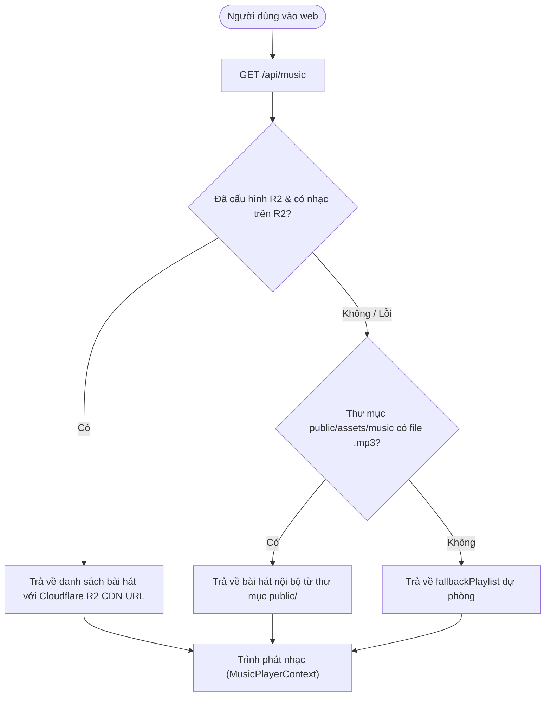

# Hướng dẫn Thiết lập & Kết nối Cloudflare R2 Storage

Tài liệu này hướng dẫn chi tiết cách thiết lập và sử dụng **Cloudflare R2** (dịch vụ lưu trữ đối tượng tương thích chuẩn S3 không tính phí băng thông tải về - *Zero Egress Fees*) cho dự án **TomatoDevs Profile**.

---

## 1. Tại sao nên sử dụng Cloudflare R2?

- **Miễn phí băng thông tải về (Zero Egress)**: Khi người dùng nghe nhạc nhiều, bạn không phải trả thêm tiền lưu lượng tải dữ liệu.
- **Dung lượng miễn phí lớn**: 10 GB lưu trữ miễn phí/tháng, 10 triệu lượt đọc (Class B) và 1 triệu lượt ghi (Class A) mỗi tháng.
- **Tối ưu Git & Vercel**: Di chuyển các file nhạc MP3 nặng (50MB - 75MB) ra khỏi Git repository giúp repo siêu nhẹ (~vài MB), clone và build trên Vercel chỉ mất vài giây.
- **CDN toàn cầu**: Cloudflare tự động cache âm thanh tại các máy chủ gần người nghe nhất (tốc độ phát nhạc tức thì).

---

## 2. Các bước tạo Bucket & Lấy thông tin trên Cloudflare

### Bước 1: Tạo R2 Bucket
1. Đăng nhập vào [Cloudflare Dashboard](https://dash.cloudflare.com/).
2. Chọn menu **R2** ở thanh bên trái.
3. Nhấn **Create bucket**.
4. Đặt tên bucket (Ví dụ: `tomatodevs-media`), chọn vị trí *Automatic* và nhấn **Create bucket**.

### Bước 2: Bật Public Access (Truy cập công khai)
Để trình duyệt web của người dùng có thể stream nhạc từ R2, bạn cần mở quyền truy cập công khai:
1. Vào tab **Settings** của Bucket vừa tạo.
2. Tìm mục **Public access**:
   - **Cách 1 (Nhanh nhất)**: Bật **R2.dev subdomain** (Cloudflare sẽ cấp cho bạn link dạng `https://pub-xxxxxxxxxxxxxxxxxxxxxxxxxxxxxxxx.r2.dev`).
   - **Cách 2 (Khuyên dùng - Chuyên nghiệp)**: Nhấn **Connect Domain** và gắn subdomain riêng (Ví dụ: `media.tomatodevs.com`).

### Bước 3: Cấu hình CORS (BẮT BUỘC để trình phát nhạc có thể tua / seek)
Trình duyệt web cần các header CORS đặc biệt để đọc file audio dạng byte range.
1. Tại tab **Settings** của Bucket, cuộn xuống mục **CORS Policy**.
2. Nhấn **Add CORS policy** và dán đoạn JSON sau:
```json
[
  {
    "AllowedOrigins": [
      "*"
    ],
    "AllowedMethods": [
      "GET",
      "HEAD"
    ],
    "AllowedHeaders": [
      "*"
    ],
    "ExposeHeaders": [
      "Content-Range",
      "Accept-Ranges",
      "Content-Length",
      "Content-Type"
    ],
    "MaxAgeSeconds": 3600
  }
]
```
3. Nhấn **Save**.

### Bước 4: Tạo R2 API Token
1. Quay lại trang tổng quan **R2** trong Cloudflare Dashboard.
2. Nhấn **Manage R2 API Tokens** ở cột bên phải.
3. Nhấn **Create API token**:
   - **Token Name**: `tomatodevs-profile-r2`
   - **Permissions**: Chọn **Object Read & Write**
   - **Apply to specific buckets**: Chọn bucket `tomatodevs-media` (hoặc All buckets)
4. Nhấn **Create API Token**.
5. Bạn sẽ nhận được:
   - **Account ID** (Tìm thấy ở góc phải trang R2 hoặc trên URL dashboard)
   - **Access Key ID**
   - **Secret Access Key**

---

## 3. Cấu hình vào Dự án (`.env.local`)

Tạo file `.env.local` ở thư mục gốc của dự án (file này đã được bảo vệ trong `.gitignore`):

```env
# Cloudflare Account ID
R2_ACCOUNT_ID="d8xxxxxxxxxxxxxxxxxxxxxxxxxxxxxx"

# R2 API Token
R2_ACCESS_KEY_ID="a1xxxxxxxxxxxxxxxxxxxxxxxxxxxxxx"
R2_SECRET_ACCESS_KEY="b2xxxxxxxxxxxxxxxxxxxxxxxxxxxxxx"

# Tên Bucket
R2_BUCKET_NAME="tomatodevs-media"

# Domain công khai đã bật ở Bước 2
R2_PUBLIC_URL="https://pub-xxxxxxxxxxxxxxxxxxxxxxxxxxxxxxxx.r2.dev"
# hoặc: R2_PUBLIC_URL="https://media.tomatodevs.com"
```

---

## 4. Tự động tải nhạc lên R2 (Chỉ với 1 lệnh)

Dự án đã tích hợp sẵn script hỗ trợ upload thông minh:
- Tự động quét toàn bộ file `.mp3` trong `public/assets/music/`.
- Tự động bỏ qua các file đã upload trước đó (không tốn thời gian upload lại).
- Tự động gắn MIME-type `audio/mpeg` và `Cache-Control: public, max-age=31536000, immutable`.

Chạy lệnh:
```bash
npm run r2:upload
```

Sau khi chạy xong, script sẽ in ra danh sách toàn bộ các URL Cloudflare R2 công khai của từng bản nhạc!

---

## 5. Cơ chế hoạt động trong mã nguồn

Hệ thống được thiết kế với cơ chế dự phòng đa tầng (*Graceful Fallback*):



- **Mã nguồn Module R2**: [`src/lib/r2.ts`](file:///home/tomato/ssd/data/Projects/profiletomato/src/lib/r2.ts)
- **API Xử lý**: [`src/app/api/music/route.ts`](file:///home/tomato/ssd/data/Projects/profiletomato/src/app/api/music/route.ts)
- **Trình phát nhạc**: [`src/components/player/MusicPlayerContext.tsx`](file:///home/tomato/ssd/data/Projects/profiletomato/src/components/player/MusicPlayerContext.tsx)

---

## 6. (Tùy chọn) Tinh gọn Git Repository sau khi upload R2

Sau khi đã chạy `npm run r2:upload` thành công lên Cloudflare R2:
Nếu bạn muốn giải phóng 250MB file nhạc khỏi Git repo để repo siêu nhẹ (~2MB), bạn chỉ cần giữ lại 1 file nhạc nhẹ làm mặc định hoặc xóa các file nhạc nặng khỏi `public/assets/music/` và commit thay đổi. Hệ thống sẽ tự động stream 100% nhạc từ Cloudflare R2!
