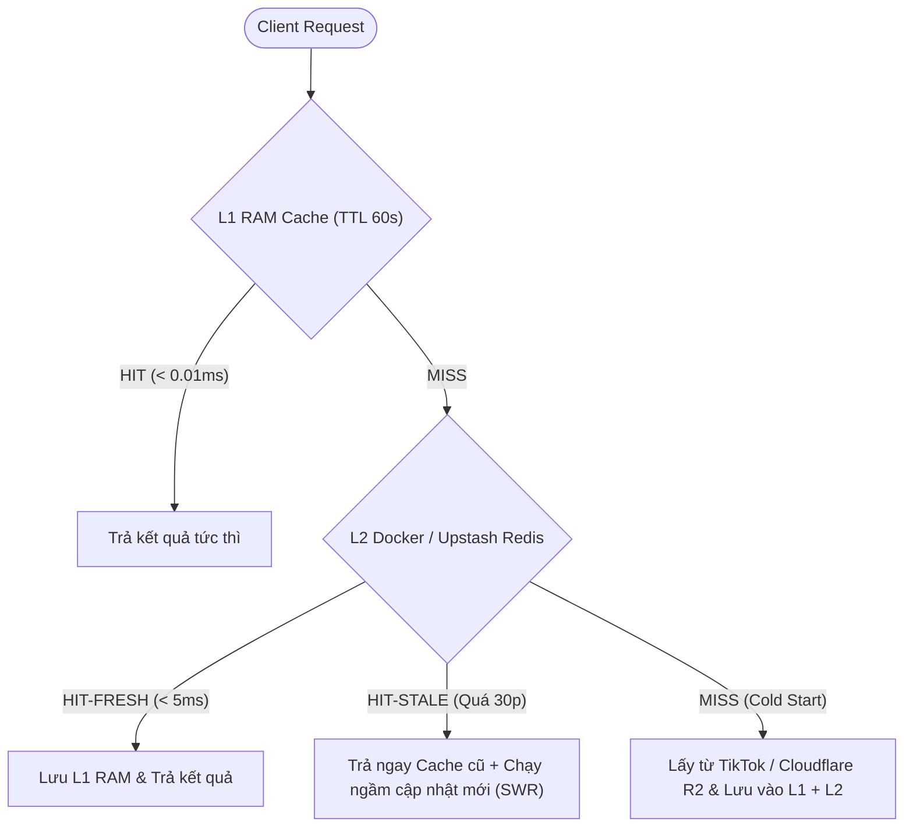

# Hướng dẫn Thiết lập & Tối ưu hóa Redis trên Docker

Tài liệu này giải thích kiến trúc **Redis trên Docker** và hệ thống **Bộ nhớ đệm Đa tầng (L1 RAM + L2 Redis)** đã được tối ưu hóa cho dự án **TomatoDevs Profile**.

---

## 1. Kiến trúc Docker Redis (`docker-compose.yml`)

Hệ thống sử dụng 2 container nhẹ trong [`docker-compose.yml`](file:///home/tomato/ssd/data/Projects/profiletomato/docker-compose.yml):

1. **`tomatodevs-redis` (`redis:7.4-alpine`)**:
   - Lõi cơ sở dữ liệu Redis 7 siêu nhẹ, bind bảo mật vào `127.0.0.1:6379` (chặn truy cập trái phép từ bên ngoài mạng).
   - **Tối ưu bộ nhớ**: Giới hạn `--maxmemory 128mb` kết hợp thuật toán `--maxmemory-policy allkeys-lru` (tự động dọn các khóa cũ ít dùng khi đầy bộ nhớ).
   - **Lưu trữ bền vững (Persistence)**: Bật `--appendonly yes` (AOF) và `--appendfsync everysec` giúp dữ liệu cache không bị mất khi khởi động lại Docker.
2. **`tomatodevs-redis-http` (`hiett/serverless-redis-http`)**:
   - Cổng cầu nối HTTP REST tại `127.0.0.1:8079` giúp thư viện `@upstash/redis` của dự án giao tiếp trực tiếp với Docker Redis cục bộ y hệt như khi chạy trên Upstash Cloud của Vercel.

---

## 2. Các tối ưu hóa hiệu năng đã áp dụng (`src/lib/redis.ts`)

### 2.1. Bộ nhớ đệm 2 tầng (L1 In-Memory + L2 Redis)
- **Tầng L1 (RAM)**: Lưu giữ dữ liệu nóng trong 60 giây ngay trong bộ nhớ tiến trình Node.js, tốc độ phản hồi **< 0.01ms**, chịu tải hàng nghìn request/giây mà không tốn băng thông socket.
- **Tầng L2 (Docker Redis / Upstash)**: Lưu giữ dữ liệu bền vững xuyên suốt các lần restart server.

### 2.2. Tối ưu `/api/tiktok-stats` với Stale-While-Revalidate (SWR) & Stampede Lock
- **Trước đây**: Mỗi lần gọi API đều phải đợi `fetch()` cào trang TikTok mất 2 – 8 giây.
- **Sau khi tối ưu**:
  - **Cache-First**: Nếu đã có dữ liệu trong Redis (dưới 30 phút), trả về ngay lập tức trong **< 5ms** (`X-Cache: HIT-FRESH`).
  - **Stale-While-Revalidate (SWR)**: Nếu dữ liệu đã quá 30 phút, API **vẫn trả ngay dữ liệu cũ cho người dùng không phải chờ**, đồng thời âm thầm kích hoạt tiến trình cập nhật ngầm trong nền (`X-Cache: HIT-STALE`).
  - **Distributed Lock (`tomato:tiktok:refresh_lock`)**: Chống hiện tượng *Cache Stampede* — khi có 100 người cùng truy cập lúc cache hết hạn, chỉ duy nhất 1 tiến trình được phép gọi lên TikTok.

### 2.3. Tối ưu `/api/music` (Giảm 99.9% lệnh gọi S3 lên Cloudflare R2)
- Danh sách bài hát từ Cloudflare R2 được lưu vào khóa `tomato:r2:music_playlist` (TTL 10 phút).
- Khi bạn chạy `npm run r2:upload` để tải nhạc mới, script sẽ **tự động xóa khóa cache này** để danh sách nhạc mới có hiệu lực ngay lập tức.

---

## 3. Các lệnh quản lý nhanh (NPM Scripts)

Bạn có thể điều khiển toàn bộ hệ thống Redis Docker chỉ bằng các lệnh `npm`:

| Lệnh | Tác dụng |
| :--- | :--- |
| `npm run redis:up` | Khởi động các container Redis chạy ngầm (`docker compose up -d`). |
| `npm run redis:status` | Kiểm tra kết nối, đo độ trễ (Ping ms) và xem chi tiết dữ liệu đang được cache. |
| `npm run redis:flush` | Xóa sạch toàn bộ cache trên Redis để ép hệ thống tải dữ liệu mới. |
| `npm run redis:logs` | Xem log hoạt động trực tiếp của Redis container. |
| `npm run redis:down` | Tắt các container Redis. |
